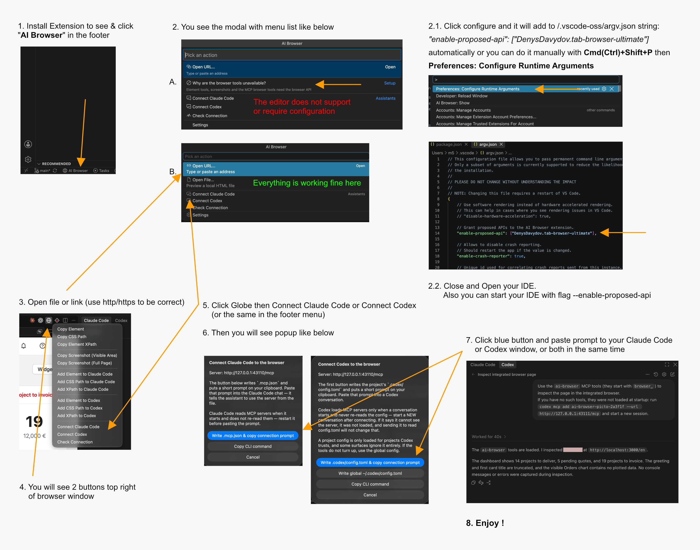

<div align="center">

# AI Browser

### Give any AI agent eyes and hands in your browser.
**One MCP server that connects VS Code's built-in browser and Google Chrome to Claude Code, Codex, Gemini CLI, OpenCode, Pi and OpenRouter.**

[](https://open-vsx.org/extension/DenysDavydov/tab-browser-ultimate)
[](https://open-vsx.org/extension/DenysDavydov/tab-browser-ultimate)


<!-- 🎬 **MEDIA-TODO · HERO GIF (10–15 s, 1200 px wide):** in the AI Browser chat, type "fix the checkout button". The agent opens the page, snapshots it, clicks, edits the code, reloads. The user watches the browser tab move on its own. End frame: the fixed page. -->

[**Install**](#-install-in-2-minutes) &nbsp;·&nbsp; [**Four ways to work**](#-four-ways-to-work-with-mcp-and-your-browser)

<!-- 🎬 **MEDIA-TODO · YOUTUBE TOUR (90 s):** add the tour link beside Install, with a thumbnail: `[](youtube-url)`. Marketplace strips iframes, so only a clickable image works. -->

</div>

---

## Why AI Browser

Front-end work is a loop: look at the page, find the element, describe it to the agent, check what changed. Screenshots lose the markup, hand-copied class names go stale, and a headless browser opens a session you are not logged into.

AI Browser closes the loop **inside your editor**. The page you are looking at is the page your agent reads and drives, with your cookies, your dev server and your logged-in state. You watch every step and can take the mouse back at any moment.

- 🔌 **One MCP server, two browsers.** VS Code's built-in browser *and* Google Chrome, with the same `browser_*` tools.
- 🤖 **Six agent systems.** Five CLIs and one API, side by side, each in its own chat tab.
- 🧰 **Everything built in.** Element picker, screenshots, video recording, annotations, saved logins, GitHub, terminals.
- 🔒 **Local only.** Loopback server, a token per workspace, no telemetry.

---

## 🔀 Four ways to work with MCP and your browser

Use the agent you already like, wherever you already work. Every route reaches the same browser tools.

<!-- 🎨 **MEDIA-TODO · DIAGRAM (SVG, to be drawn):** four lanes — *Native extension*, *Native terminal*, *AI Browser chat*, *Terminal in the chat* — all arrows go into one box "AI Browser MCP server", which splits into "VS Code browser" and "Google Chrome". -->

| | Route | Best for | What you get |
|---|---|---|---|
| **1** | **Native extension** (Claude Code, Codex, …) + our MCP | You live in the agent's own panel | One click on **Connect**. The agent gets browser tools and can share the page you are looking at. |
| **2** | **Native terminal** (`claude`, `codex`, `gemini`, …) + our MCP | You prefer the CLI | The same tools from any terminal agent. Connect once per project. |
| **3** | **AI Browser chat** | One place for every agent | Six agents, tabs, approvals, queues, page sharing, element picker, GitHub. The tools are wired in from the first message, no setup. |
| **4** | **Terminal inside the chat** ⭐ | Maximum power | A real shell or agent CLI as a chat tab. **All MCP tools are available**, including `terminal_*`: the agent reads your screen, types with your approval, and you watch it work. |

<!-- 🎬 **MEDIA-TODO · 4 SHORT GIFs (5–8 s each), one per route:**
1. Click **Connect Claude Code** in the browser menu, paste, the agent answers `browser_state`.
2. `claude` in a terminal, "open localhost:3000 and screenshot it".
3. The AI Browser chat opening a page and clicking.
4. A terminal tab in the chat, with the agent running tests and reading the output. -->

### ⭐ Route 4 in detail: a terminal your agent can see

Open a shell as a tab in the chat (an agent's own CLI can be a tab too), then pin the shell to a conversation with **Ask agent**. That agent can:

- **read** the screen (the real rendered screen, not a pile of control codes),
- **wait** for a command to finish or for text to appear,
- **type** and press keys, after you approve each input,
- do all of it **next to the browser tools**, so a single agent can edit, run, look and verify.

You can pause the agent's input at any time, or share a terminal in watch-only mode. Optionally, share terminals securely with the Chrome side panel or your phone through the Exchange website.

<!-- 🎬 **MEDIA-TODO · GIF (10 s):** agent runs `npm test` in a pinned terminal tab, reads the failure, fixes the file, reruns, the browser tab refreshes. -->

---

## 🌉 Chrome and VS Code, one bridge

Your agent is not limited to the editor. The same MCP server drives **Google Chrome** with no Chrome extension needed. Open a Chrome tab from the status bar menu, and the agent gets the same `browser_*` tools there.

- Tabs from both browsers appear in one list.
- Give one tab to one agent: it can see and drive **only that tab**.
- Works with Claude Code, Codex, Gemini CLI and every other MCP client.

<!-- 🎨 **MEDIA-TODO · SCREENSHOT:** the `browser_tabs` list showing a VS Code tab and a Chrome tab, with a Chrome tab marked as shared with Codex. -->

### 🧩 The Chrome side panel

Want the chat inside Chrome itself? The **Chrome extension** brings the AI Browser chat, terminals and approvals to a Chrome side panel, paired with your editor in two clicks (**Connect** in Chrome, **Allow** in VS Code). See [installation and limits](chrome-extension/README.md).

<!-- 🎬 **MEDIA-TODO · SCREENSHOT or GIF:** the Chrome side panel beside a web page, with the chat streaming and a terminal tab open. -->

---

## 🧠 Six agents, side by side

| Agent | Type | Browser tools |
|---|---|---|
| **Claude Code** | CLI | ✅ built in |
| **Codex** | CLI | ✅ built in |
| **Gemini CLI** | CLI (ACP) | ✅ built in |
| **OpenCode** | CLI (ACP) | ✅ built in |
| **Pi** | CLI (RPC) | ✅ built in |
| **OpenRouter** | API, plus local Ollama and LM Studio | ✅ built in |

Run several in neighbouring chat tabs at once. Start a second opinion from any reply with one click, hand a conversation over to another agent, or continue it in a terminal. Everything runs on **your own subscriptions and sign-ins**: the chat drives the CLIs you already have installed.

<!-- 🎬 **MEDIA-TODO · GIF (8 s):** three chat tabs with different agents working at the same time; one page shared to two of them. -->

<!-- ⚠️ **TODO (owner):** the brief mentioned 7 agent systems (6 CLI + 1 API). The code currently ships 5 CLIs + OpenRouter. Update the count above and the badge when the sixth CLI exists. -->

---

## ✨ Everything else, at a glance

| |
|---|
| **🔗 Share pages between agents**<br>One tab can go to one agent, or to all of them. An agent with its own tab cannot see your other tabs. <!-- MEDIA-TODO: GIF of Share Tab --> |
| **📡 Watch background work**<br>See what your agents and their sub-agents are doing: background commands, spawned processes, running tasks. Inspect any process live, stop it with one click. <!-- MEDIA-TODO: screenshot of the Bash/Activity tab --> |
| **🐙 GitHub, built in**<br>Quick commits with generated messages, stage and unstage, push, publish and open a PR from the chat. Open a GitHub repo as a separate copy, a clone, or a read-only reference. <!-- MEDIA-TODO: GIF of commit then PR --> |
| **🗂️ Tabs and workspace**<br>A wide sidebar or a narrow strip. Drag tabs to reorder, move them to a new window, group them by project, pin the important ones. <!-- MEDIA-TODO: GIF of dragging tabs, wide to narrow --> |
| **🖥️ Share a terminal with the agent**<br>Pin a terminal to a conversation and follow every command it runs. <!-- MEDIA-TODO: see route 4 --> |
| **🌐 Chrome extension**<br>The chat, terminals and tools, in the Chrome side panel. <!-- MEDIA-TODO: Chrome panel screenshot --> |

---

## 🛠️ Browser tools you can use yourself

Every tool below works from the browser tab's toolbar. Agents get the same abilities through MCP.

| Tool | What it does |
|---|---|
| 🎯 **Element picker** | Click an element and get its markup, box, matched CSS and inherited rules. Or just a stable CSS selector or XPath. |
| 📌 **Page sharing** | Attach the page, with its address and tab id, to any chat. |
| 📸 **Screenshots** | The visible area or the whole page, straight to the clipboard or the chat. |
| 🎥 **Video recording** | Record the page in up to 4K. No OS screen-recording permission needed. |
| 📍 **Annotations** | Pin numbered notes to elements. Sending the message hands them to the agent. |
| 🔑 **Logins and passkeys** | Save and fill logins, with passkeys, in VS Code's secret storage. |
| 🌍 **Translate or rewrite the page** | The agent rewrites text in place: translate, test long labels, mask personal data. A reload restores it. |

<!-- 🎬 **MEDIA-TODO · GIF per tool (5 s each):** picker, annotation, recording, screenshot. Combine into a 2×2 grid image if space is tight. -->

---

## 📦 Install in 2 minutes

1. **Install the extension.**
   - **VSCodium, Devin, Cursor, Windsurf:** [Open VSX](https://open-vsx.org/extension/DenysDavydov/tab-browser-ultimate) — one click.
   - **VS Code:** download [`tab-browser-ultimate.vsix`](https://github.com/Denis-Davidoff/vs-code-tab-browser-ultimate/raw/main/tab-browser-ultimate.vsix) → **Extensions: Install from VSIX…**
2. **Enable the browser API (VS Code, VSCodium, Devin).** Click the orange **Enable Browser API** button in the status bar, then quit and reopen the editor. *Skip this for Google Chrome: it needs no setup.*
3. **Open a page and chat.** Run **AI Browser: Show**, enter a URL, then open the **AI Browser** chat in the secondary side bar and say what you want.

<!-- 🎬 **MEDIA-TODO · GIF (8 s):** install, click Enable Browser API, restart, first page open. -->

[](https://raw.githubusercontent.com/Denis-Davidoff/vs-code-tab-browser-ultimate/main/ai-browser-instruct.jpg)

### Editor support

| Editor | Built-in browser | Google Chrome | Install |
|---|---|---|---|
| **VS Code** 1.112+ | ✅ | ✅ | `.vsix` |
| **VSCodium** | ✅ | ✅ | Open VSX |
| **Devin** (Windsurf) | ✅ | ✅ | Open VSX |
| **Cursor** | — | ✅ | Open VSX or `.vsix` |
| **Antigravity IDE** | — | ✅ | Open VSX or `.vsix` |
| **Kiro** | — | ✅ | Open VSX or `.vsix` |
| **Trae** | — | ✅ | `.vsix` |

Checked on 2026-09-09 in shipped builds. In editors without a native browser, use Google Chrome with the same tools. The VS Code Marketplace carries only a guide, because it does not accept extensions that use proposed APIs.

The AI Browser chat needs **VS Code 1.106 or newer** and runs on macOS and Windows for terminals.

---

<details>
<summary><b>🧰 Reference: the toolbar on the browser tab</b></summary>

Open a page and the browser tab gets two buttons: a **globe** menu holding everything the extension does, and a **crosshair** that repeats your last action (`Cmd`/`Ctrl` + `Alt` + `C`).

| Entry | Result |
| --- | --- |
| Open New Browser Tab | an empty browser tab |
| Connect Claude Code / Codex / Gemini CLI | writes the agent's config and shares this tab with it |
| Copy Element | full context as Markdown: element, URL, HTML path, outer HTML, dimensions, matched CSS |
| Copy CSS Path / XPath | `#main > div > li:nth-of-type(2)` or `//*[@id="main"]/span` |
| Copy CSS Path + Location | `http://localhost:3000/a/b → #main > div > li:nth-of-type(2)` |
| Copy Screenshot | visible area or full page, as a real PNG on the clipboard |
| Record Video | 1080p, 1440p or 4K, silent MP4 or WebM |
| Translate Page… | copies a prompt that makes your agent translate the page in place |
| Add Annotation Marker | pin a numbered note to an element |
| Claude Code ▸ / Codex ▸ / Gemini CLI ▸ / AI Browser Chat ▸ | hand picks to that agent, connect, share the tab |
| Check Connection | verifies the MCP server and your configs |
| Logins and Passkeys ▸ | fill, save, manage, import, export |
| Share Tab with All Assistants / Stop Sharing Tab | control who can use this tab |

</details>

<details>
<summary><b>💬 Reference: working in the chat</b></summary>

- 📎 **Attachments** as `@1`, `@2`: type **@** to find an attached file, page, element or screenshot.
- 🪄 **Quick-skill toolbar** above the message box, with parameters, chained prompts and checks between steps.
- 📂 **Local links in replies** open files at the right line and folders in Explorer.
- 🏷️ **Automatic chat titles** from a short, bounded background request.
- 📊 **Indicators** for approvals mode, context fill (click to compact) and plan limits.
- 💻 **Continue a chat in a terminal:** right-click a chat tab → *Continue in VS Code terminal*.

Full reference: [CLAUDE.md](CLAUDE.md).

</details>

<details>
<summary><b>🧪 Reference: use from another extension</b></summary>

```ts
await vscode.commands.executeCommand('aiBrowser.api.open', vscode.Uri.parse('http://localhost:3000'), {
    viewColumn: vscode.ViewColumn.Beside,
    preserveFocus: true,
});
```

A plain string works too and is relayed exactly as given. The extension also registers an external URI opener for `http` and `https`, but only for localhost-like hosts.

</details>

---

## More

- 📜 [Changelog](CHANGELOG.md) · 🔐 [Privacy Policy](PRIVACY.md) · 📖 [Full reference](CLAUDE.md)
- 🧩 Try another extension: **Task & Script Explorer** on the [VS Code Marketplace](https://marketplace.visualstudio.com/items?itemName=DenysDavydov.task-runner-ultimate) or [Open VSX](https://open-vsx.org/extension/DenysDavydov/task-runner-ultimate).

## License

Outside `exchange-server/`, MIT, with both copyright lines: Microsoft's, for the forked and copied code, and this project's. The per-file MIT headers on everything copied from VS Code stay where they are. One file, `src/logins/loginFormScript.ts`, is ported from Firefox's password manager and stays under the Mozilla Public License 2.0; see [THIRD-PARTY-NOTICES.md](THIRD-PARTY-NOTICES.md).

Exchange Server is licensed separately under [Elastic License 2.0](exchange-server/LICENSE). Personal and internal company use are free. Providing its substantial functionality to third parties as a hosted or managed service, whether paid or free, requires separate permission. See [licensing scope and exceptions](exchange-server/LICENSING.md). Previously granted MIT rights and third-party licenses remain in effect.
