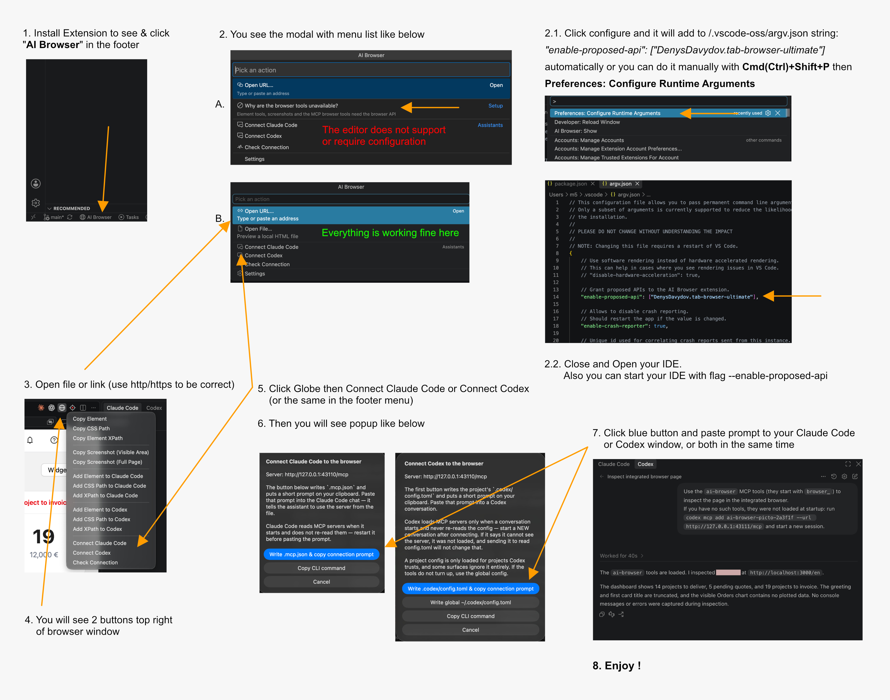

# 🚀 First integrated browser for VS Code editor with Claude Code, Codex, Gemini CLI, OpenCode, Pi and OpenRouter support 🎆

- 🌐 **VS Code’s built-in browser or Google Chrome:** work in a native browser tab inside the
  editor where available, or let your assistant drive Google Chrome without a Chrome extension.
- 🤖 **Your assistants, your way:** keep the Claude Code and Codex extensions or the Gemini CLI you
  already use, or switch to the **AI Browser chat** — Claude Code, Codex, Gemini CLI, OpenCode, Pi and
  OpenRouter models in one panel, up to 10 chats at once, more deeply wired into the browser.
- 🔌 **A built-in MCP server** that connects the browser to Claude Code, Codex, Gemini CLI or any
  other assistant that speaks MCP.
- 🎯 **Pick an element on the page** and send its address or metadata straight to Claude Code or
  Codex.
- 🛠️ **Full DevTools for every tab.**
- 🔗 **Per-assistant tab access:** share a tab with one assistant and it sees and drives that tab
  only, while the others stay hidden from it.
- 🔑 **A password manager for sites:** it offers to save a login after a sign-in that worked and
  fills it back, with passkeys too, all kept in VS Code's secret storage.
- 🌍 **Translate, modify and restore content on the page:** your assistant rewrites all of its
  text in place — translate it, stress-test the layout with long labels, try new copy, or mask
  personal data before a screenshot. Only the open page changes; a reload restores it.

## 🌐 Browser options by editor

AI Browser works with **VS Code’s native browser** and **Google Chrome**. In editors that
expose the `browser` API, pages can open directly inside the editor. In other editors, use
Google Chrome with the same browser tools for your assistant.

The native browser availability below was checked in shipped builds on **2026-09-09**;
it may change in newer releases. Google Chrome is also an option in the editors with native tabs.

| Editor | Version checked | VS Code Browser | Google Chrome | How to install |
|---|---|---|---|---|
| **VSCodium** | 1.135 | ✅ | ✅ | Open VSX |
| **Devin** (Windsurf) | 1.126 | ✅ | ✅ | Open VSX |
| **VS Code** | 1.137 | ✅ | ✅ | Install the `.vsix` |
| **Cursor** | 3.19.19 | — | ✅ | Open VSX or `.vsix` |
| **Antigravity IDE** | 1.107 | — | ✅ | Open VSX or `.vsix` |
| **Kiro** | 1.0.437 | — | ✅ | Open VSX or `.vsix` |
| **Trae** | 1.107.1 | — | ✅ | Install the `.vsix` |

In the chat’s **+** menu or browser button, choose **Google Chrome** or **VS Code Browser**.
The native option appears where available and offers to enable it if needed; then quit and
reopen the editor. Chrome and agents work without this setup. Alternatively, for Chrome,
choose **Open Google Chrome for your agent** in the status bar menu, select your assistant,
and paste the copied prompt into its chat. Chrome needs to be installed on the same computer,
and this mode runs from a local editor window.

**Setup at a glance** — the whole path in eight numbered steps; click the picture for full size:

[](https://raw.githubusercontent.com/Denis-Davidoff/vs-code-tab-browser-ultimate/main/ai-browser-instruct.jpg)

The experimental **Chrome chat side panel** can display a live conversation and its
settings from a local editor window, without chat tabs. See
[installation and current limits](chrome-extension/README.md). It uses the same chat
interface and editor theme, with messages, Stop, approvals, model selection and chat settings.
Choose **Connect** in Chrome and **Allow** in the editor chat to pair without copying codes.

See the [Privacy Policy](PRIVACY.md) for data handling, storage and provider sharing.

## 💻 Continue a chat in a terminal

Choose **Continue in VS Code terminal** from a chat tab's right-click menu or the chat command
picker, or use the terminal button beside a conversation in **History**. Claude Code,
Codex and Gemini CLI open in a VS Code editor terminal tab, resuming the saved session
in its original folder. Finish the running turn and any queued messages first.
The chat tab closes and remains in history. Repeating the action focuses its existing
terminal; close that terminal before reopening the conversation in chat.
The chat transcript does not import messages subsequently written in the terminal.
The CLI keeps the browser tools and the tab the chat was working on.

## 🧠 Agents in the chat

Claude Code, Codex, Gemini CLI, OpenCode, Pi and OpenRouter (including local Ollama or LM Studio
models) — set up in **Chat Settings**; details in [CLAUDE.md](CLAUDE.md#the-ai-browser-chat).

## ⌨️ Terminal tabs

Open a shell, or an agent's own CLI, as a tab in the chat (the strip's **+**, or **AI Browser: New
Terminal**; macOS and Windows). Pin it to a conversation with **Ask agent** and that agent can read the
screen and, after you approve each input, type into it. Remote access is opt-in, see
[CLAUDE.md](CLAUDE.md#terminal-tabs-a-real-shell-in-the-chat).

## 📍 Page annotations

**Add Annotation Marker** on the browser tab pins a numbered note to an element you click. Each new
note is attached to the AI Browser chat tab in front, and assistants read, add and remove notes
through the `browser_annotations_*` MCP tools. Sending the message removes its markers from the
page. Details: [CLAUDE.md](CLAUDE.md#page-annotations).

## 🎥 Browser video recording

Record the browser page without OS screen recording permission. Videos are silent,
saved as MP4 when supported or WebM otherwise. Choose **1080p**, **1440p** (default)
or **4K** in **Chat Settings → Video recording**.

- **AI Browser Chat:** select **+ → Record the browser page**. Stop attaches the video
  to your draft; open it to preview or choose **Save video as…** to keep it.
- **Claude Code / Codex extensions:** start from the assistant’s browser menu. Stop copies
  the file path and offers **Open video** and **Save as…**.
- **MCP:** use `browser_recording_start`, `browser_recording_pause`,
  `browser_recording_resume`, `browser_recording_stop` and `browser_recording_status`.

Use **Pause / Resume** and **Stop** in the chat or native browser toolbar. Keep the page
visible while recording. Files are temporary until saved; agents receive a file reference.
For limits, settings and technical details, see [CLAUDE.md](CLAUDE.md#browser-video-recording).

## 📝 Changelog

**0.9.6** — The selected, visible chat finishes silently by default while its VS Code or browser window is active. Enable **Play a sound for the active chat** in Chat Settings → Sound & notifications to hear it too. Background chats and inactive windows still play finish sounds when sound is enabled; Chrome and the website can keep their own setting per device.

**0.9.5** — Finish sounds (fifty, volume up to 200%, repeated up to five times) and system notifications when agents finish, also in Chrome and on the website. Chats load only their last turns, with earlier ones on scroll, so remote connections open faster. The website's message box stays visible above a phone keyboard.

**0.9.4** — The OpenRouter agent also runs models from Ollama or LM Studio on your computer (no key needed or sent). Chat Settings has a **Remote terminals** tab with checkboxes for what Chrome and the website
may do with terminal tabs: use them at all, open a plain terminal, open an agent in a terminal. Each
applies at once, and they can be changed only in VS Code.

**0.9.3** — Adding a chat reuses an existing empty tab and briefly highlights it instead of creating a duplicate.

**0.9.2** — A tidier tab strip: the tab in front is always 35% wider than the rest and switches
with a quick linear animation. When tabs overflow, the remaining ones share the full width and
hovering the dropdown opens the list, where a hovered row has a close button and a tab picked
from it stays in the strip. Gemini CLI can be opened in a terminal tab, and dragging terminals
to reorder them works again. The Chrome side panel and the website share all of it.

**0.9.1** — Terminal tabs in the chat: a real shell, or Claude Code or Codex in their own CLI,
beside your conversations. Pin one to a conversation and its agent reads the screen and, with your
approval, types; **Watch only** and **Pause agent input** keep it in check. The terminal toolbar
inserts pages, elements, screenshots and files into an agent CLI's prompt. Opted in, the Exchange
website can watch shared terminals and take control, with a key bar for phones.

**0.9.0** — The Exchange server shares a chat and a browser tab with a self-hosted website,
end-to-end encrypted. From any device you can send messages, stop turns, pick elements and
click through the page. The VS Code chat, the Chrome side panel and the website share one set
of controls and receive updates as patches. Git state made in VS Code reaches the website
straight away. Chrome and the website offer the current page as a one-click attachment. The
website can open Google Chrome on the VS Code machine and labels each tab by browser. Agents
can no longer send clipboard shortcuts. The Chrome extension is now 0.6.0.

**0.8.10** — Agents gain native hover, drag, keyboard shortcuts and text insertion,
plus double and right clicks. Browser snapshots and actions reach open and closed
Shadow DOM; pointer actions handle scaled, rotated and perspective-transformed iframes,
including nested frames from other sites. Optional humanized input adds curved pointer
movement, varied pauses and character-by-character Unicode typing. Clicks refuse covered,
disabled or ambiguous targets, and cancelled actions release held keys and mouse buttons.

**0.8.9** — Popups and tooltips stay within the visible chat area, including narrow
Chrome side panels, and adjust when the panel or content changes size. Chrome video
recording has a timer and Pause/Resume/Stop controls above the composer; Chrome's
Stop sharing control also ends recording. The Chrome footer supports usage and context,
skills, working folders, Git branches and commits, and GitHub repositories, with
conversation-bound action results and replay protection for project attachments.
Reconnects preserve command receipts; uncertain sends after an editor restart return
to drafts for review. Subtask failures settle their status, and a watchdog checks
quiet agents without terminating genuinely active work.

**0.8.8** — Continue an editor conversation in Chrome's side panel with quick pairing,
conversation selection, separate drafts, messages, Stop, approvals and model settings.
Attach page elements, screenshots, annotations, page links, files and short recordings;
agents can manage enabled Chrome annotations through MCP. Mirrored editor tabs have an
animated gradient underline. The Chrome footer supports usage, context, skills, working
folders, Git branches and commits, and GitHub repositories. Compatibility is checked per feature, and the Chrome UI
and help are in English. Includes matching Chrome icons, store listing text and
`npm run package-chrome` for creating an installable ZIP.

**0.8.7** — Chrome and agents work without the native Browser API. The chat’s **+** and
browser menus offer Chrome and, where available, native tabs with one-click API setup.
Chrome opens attach the requested tab; sharing, screenshots, element picks and video recording
work with Chrome. A Codex chat stays open when another conversation prevents terminal handover.
The README has a clearer browser comparison and a shorter recording guide.

**0.8.6** — The browser tools can drive Google Chrome, with no Chrome extension. A chat moved
to the terminal keeps the browser tools and the tab it was working on. Chat history can be
filtered by period. A "Prompt is too long" hit during auto-compacting is retried.

**0.8.5** — Claude Ultracode gets its own round toggle beside effort, remembered per chat;
new tabs inherit the last chosen state. A collapsed sidebar keeps chats visible as compact,
colour-bordered tiles with status icons and agent counts. Effort uses a fixed-width slider
with a soft colour scale and an immediate tooltip. The folder footer has shorter labels
and refined spacing.

**0.8.4** — A wide-screen chat layout from 1000 px: a centered conversation and composer,
with tabs in a collapsible sidebar on either side. Attachment references start at `@1` for
each new message. Claude and Codex automatically continue after temporary service errors,
with up to three retries after 5, 15 and 60 seconds. Chat tabs have a centered orbit spinner
and smoother switching animations; closed chat panels release their display numbers for reuse.

**0.8.3** — Publish, push and pull the current branch from the chat's Branches window,
through VS Code's Git extension and your GitHub sign-in, with a button for a pull request. New
`chat_*` MCP tools report the chat's tabs, plan limits and agents, and let the chat's own agents
keep the computer awake, pause their queue or stop one of their agents, behind a new Chat
control approval category. The status bar menu opens new chats, and Gemini shows the model
Auto chose and explains quota, context and exit errors.

**0.8.2** — Open chats in the sidebar, editor tabs or separate windows, and move them
between views with their sessions, drafts and attachments intact. View chats side by side
across screens, drag to reorder, and restore chat tabs after restarting VS Code. The top
**+** offers a location; the tab-strip **+** adds a neighbouring chat. History finds chats
already open elsewhere and offers to move them back to the sidebar.

**0.8.1** — File names throughout the chat now show icons from your selected file icon
theme, including attachments, file links and read/edit tool rows. Usage and context indicators
use clockwise ring meters, and the composer has a darker surface below its toolbar. Generated
commit subjects use conventional commit format with a task ID from the branch or recent
commits when available.

**0.8.0** — Gemini CLI joins the chat as a third agent, driven over ACP through your own
`gemini`, with **Connect Gemini CLI** writing `.gemini/settings.json` (token kept out of git),
**Open Gemini CLI in Terminal** and **Share Tab with Gemini CLI**. **Ask another agent** under a
reply sends the same question to another agent or model in a new tab for a second opinion. New
`editor_*` MCP tools let assistants see what is open and selected, show a place, and find
definitions, references and symbols through VS Code's language servers.

**0.7.19** — A maximum video length in Chat Settings (5 minutes by default, 10 seconds to 1 hour),
with the Stop button blinking red and a countdown in the status bar for the last 30 seconds. The
empty chat lists the features worth trying, one line each, above the changelog. A prompt Claude Code refuses as too long is sent again after it compacts. Annotation
markers keep their elements across a reload, and an empty note is deleted without a question.

**0.7.18** — Page annotations: numbered notes pinned to elements, attached to the chat and
removed from the page once the message is sent, with `browser_annotations_*` tools for the
assistants. A View Mode for the chat — Minimal, Compact or Standard. One repeat button on the
browser tab for the last action, a copy or a marker. Files, folders and editor selections
attached from VS Code, and a shared page that follows its tab. Safe branch switching with
stash, commit or discard first, and diffs from the Git footer.

**0.7.17** — Video recording of browser pages (three quality presets, pause and stop on the tab,
`browser_recording_*` tools for the assistants; both limits keep the video). Files pasted into the
chat are attached. Temporary files moved to `~/.ai-browser`, with per-project cleanup in Chat
Settings. Custom system prompts for commit messages, branch names and titles, automatic
keep-awake while agents work, and themed file icons in the Git footer. Command tools such as
PowerShell are approved under Terminal; a rejected password is no longer offered as an update;
Restricted Mode runs no Git; unsaved skill and settings edits survive focus changes.

**0.7.14** — Git controls in the chat footer: inspect staged and unstaged files, stage or unstage
changes, refresh status, and search, switch, create or delete branches. The sparkle button suggests
a branch name from changes or discussion using a lightweight model at the configured effort. Commit
with an AI-generated message, choosing staged changes or all changes;
failures offer agent assistance, and successful commits show a ten-second VS Code notification.
The settings gear beside the keep-awake cup opens **AI for Extension Features**, with independent
agent (Auto, Claude Code or Codex) and effort (Minimum, Medium or Maximum) choices for commit
messages, branch names and chat titles, saved across projects.

**0.7.13** — Voice messages on macOS 26+: record from the microphone under Send, transcribed on
the device and written into the message box for review before sending. The keep-awake cup moved
to the chat's title bar, and "until the agents finish" can follow this tab or all tabs.

**0.7.12** — Attachment references (`@N`) with an **@** picker; toolbar skills with a wand-shaped
Add button, drag-and-drop ordering and an expandable list; follow-up prompts wait for their
sub-agents. Local file links open in editor tabs and folder links in VS Code Explorer or the
system file manager. Lightweight background requests name new chats without replacing manual
names. Unused managed GitHub copies can be deleted from the folder menu. Mode counts and context
usage are colour-coded, and popups close when focus leaves the panel.

**0.7.11** — A responsive chat composer: toolbar groups adapt to the sidebar width, effort has a
compact selector, Send and queued-send sit beside the message box, and the working folder has
its own status line.

**0.7.10** — A smaller keep-awake cup, matching the context and usage icons.

**0.7.9** — Keep-awake. The cup button in the chat keeps the computer from sleeping for a set
time, or until this window's agents and sub-agents finish. Codex agents and nested agents keep
their place in the agents list after the turn that started them, and Stop or closing the tab ends
them.

**0.7.8** — Plan limits in sight. A line above the chat appears once your agent's nearest limit is
90 % used, says when it resets, returns at every further percent and at 100 % after you close it,
and tells you when the agent starts spending usage credits. The **U** button is coloured by how much
of the plan is used and turns red when a limit is reached. The figures are read from what the agents
already report, without starting extra processes.

**0.7.7** — Follow-up fixes to 0.7.6. Saved logins notice an Enter sign-in again on forms whose
button is an arrow or in another language. Connect Codex and the startup repair no longer stop at a
config holding servers in another TOML spelling. The toolbar's Copy button in a folderless window
keeps the Add button in your other windows, an element's id can no longer become a command link in
a saved report, `browser_console` clears only what it returned, and messages given back by Stop or
Clear join your earlier draft rather than a recalled message.

**0.7.6** — Fixes from a review of the whole project. Saved logins no longer take a "Forgot
password?" button for a sign-in, and undo a save from an offer that turns out wrong. The chat's
buttons answer every click while a reply streams, an input method's Escape no longer closes a form,
and messages given back by Stop or Clear are kept. A fetched repository's own skills stay off until
trusted, Add to Claude Code is hidden with no folder open, Codex configs in other TOML spellings
are left intact, and `browser_console` answers stay within a tool's size limit.

**0.7.5** — A working folder per chat: the folder button beside **/** sets where the agent works
and lists that folder's files to attach. GitHub repositories open three ways — a separate copy on
a branch of its own (with its changes, push and pull request), a clone into a folder, or a
read-only checkout beside the project — and a fetched repository's own Claude Code settings stay
off until you trust them. Toolbar skills can show their result in a notification and tell you
when they end.

**0.7.4** — Questions with choices: when the agent asks, a form opens above the message box with
a tab per question, and Answer sends once every question has an answer. Links in replies open in
the built-in browser (⌘/Ctrl-click: the system browser), and the file a tool row names opens on a
click. Tool calls start folded with a line saying what each does, toolbar skills can run after the
current turn, and headings, quotes and code blocks in replies are restyled.

**0.7.3** — Toolbar skills can send several prompts in a row, each once the agent has finished the
one before — and, where you write a check between two, only if the agent finds it true. A small
pie beside **U** fills as the conversation uses up the model's context window; click it to compact
the conversation with the agent's own `/compact`. The button that queues a message for after the
current turn is now Send's twin, in the accent colour.

**0.7.2** — Toolbar skills running in the background show in the agents list with their tool
calls, reply and a Stop; the foot of the chat says how long the agents have been running; the
**/** palette cuts long rows instead of scrolling sideways.

**0.7.1** — Toolbar skills: buttons above the message box running prompts of your own — with
parameters, your agents' skills and colours of your choice — into the chat, to the clipboard or
silently in the background, also callable as **/name**. Tool calls show the first lines of their
input and output and open whole in an editor tab; a file change opens in VS Code's diff editor.

**0.7.0** — The AI Browser chat, in the secondary side bar: talk to Claude Code or Codex with the
CLI you already have, pick the agent, model and effort, and attach screenshots, page elements, the
address or files. Its agents can use the browser from the first message and ask before they act —
answered in the chat, or set to Auto, Ask or Deny per kind. Several chats at once as tabs, the
agents' skills under **/**, and the sub-agents they start listed with a Stop for each.

**0.6.3** — Assistants can now read and work inside embedded frames, including ones from other
sites — a OneNote notebook in SharePoint, a document viewer, a payment form. A new
`browser_frames` tool lists them, the reading, clicking, filling and waiting tools take a frame,
and a new `browser_scroll` scrolls a page, a frame or an inner panel.

**0.6.2** — Fixes across the board: the password manager no longer offers to save a password after
a link or a rejected sign-in, while catching sign-in buttons in any language; `browser_wait_for`
survives the navigation it waits for; screenshots of right-to-left pages are no longer blank; and
Codex config repairs leave hand-written entries alone.

**0.6.1** — Translate Page: pick a language and paste the prompt into Claude Code or Codex, and the
assistant rewrites the page's text in place through three new MCP tools — which also serve any
other bulk rewrite, from new copy to masked data before a screenshot.

**0.6.0** — Saved logins and passkeys: the browser offers to save a password after a sign-in
that worked, fills it back with `Cmd`/`Ctrl` + `Shift` + `L`, and stores passkeys — all in VS
Code's secret storage, with encrypted export and import from Chrome, Firefox, Safari, Bitwarden
and 1Password.

**0.5.30** — Screenshots for Claude Code fixed: `browser_screenshot` now returns real images
instead of base64 text, which overflowed the tool output limit, and a full page arrives as a
sequence of frames sized for the model to read.

## 📦 How to install

Choose the browser you want to use: **native tabs inside the editor** or **Google Chrome**.
For native tabs, run **AI Browser: Enable Integrated Browser API** (also under *Setup* in the
status bar menu) to check your editor and enable access. For Chrome, choose
**Open Google Chrome for your agent** in the status bar menu; no Browser API setup is needed.

> **The fastest way in is the VSIX in this repository:**
> [**tab-browser-ultimate.vsix**](https://github.com/Denis-Davidoff/vs-code-tab-browser-ultimate/raw/main/tab-browser-ultimate.vsix)
> → **Extensions: Install from VSIX…**. It is the current build.
>
> [**Open VSX**](https://open-vsx.org/extension/DenysDavydov/tab-browser-ultimate) carries the
> same build, and is the one-click route on VSCodium, Devin, Cursor and Windsurf —
> see the table above for the browser option in each editor. The
> [**VS Code Marketplace**](https://marketplace.visualstudio.com/items?itemName=DenysDavydov.tab-browser-ultimate-promo)
> entry is the guide and the download link, not the extension itself — the Marketplace does not
> accept an extension that declares API proposals. See [Installing](#installing) below.
>
> For native browser tabs there is **one step after installing**: the extension declares two API
> proposals (`externalUriOpener`, `browser`) and an editor only grants those to an extension
> named with `--enable-proposed-api`. Click the orange **Enable Browser API** button in the
> status bar and it writes that for you — see
> [Enabling the browser API](CLAUDE.md#enabling-the-grant-in-one-click).

For native tabs, press `Cmd`/`Ctrl` + `Shift` + `P` to open the command palette, run
**AI Browser: Show**, and enter the URL. For Google Chrome, use the status bar action above
and ask your assistant to open the page.

**Your browser, wired to your AI assistant: use native editor tabs or Google Chrome and let
the agent drive the page. In native tabs, you can also pick an element and send it as a prompt.**

Front-end work is a loop: look at the page, find the element, describe it to the assistant,
check what changed. Screenshots lose the markup, hand-copied class names go stale, and a
headless browser opens a session you are not logged into. This extension closes the loop inside
the editor: the page you are looking at is the page your agent reads and drives.

- 🌐 **VS Code's built-in browser, not a webview approximation.** Pages open in the editor's own
  browser editor — a real Chromium tab with history, find in page, page zoom, DevTools and
  working keyboard shortcuts. The extension attaches to it over the Chrome DevTools Protocol,
  the same channel the editor uses for its own browser features.
- 🎯 **Click an element, get the whole story.** One pick returns a report: what the element is,
  where it sits in the html, its outer markup, its box, and the css that actually applies to it
  — matched rules in cascade order, inherited rules, resolved values and css variables. Hover
  highlighting comes from the DevTools overlay, so picking feels like the inspector.
- 📍 **Or just its address.** A CSS selector or an XPath, built to survive the next rebuild:
  both anchor on a unique `id` when there is one and add a positional predicate only where a
  tag really repeats; the selector deliberately leaves utility class names out. **Copy CSS
  Path + Location** puts the page in front of it — `http://localhost:3000/checkout → #main >
  li:nth-of-type(2)` — so an assistant reading it knows which route the selector belongs to
  instead of guessing, in the order it will use them: navigate, then find. It arrives on the
  clipboard already wrapped as inline code, ready to paste into a chat message.
- ✨ **One click turns it into a prompt.** Send the element, its selector or its path straight
  into Claude Code or Codex as a file their agent reads — so "make this button match the one
  above" is a sentence, not a paragraph of description.
- 📸 **Screenshots that paste as pictures.** The visible area or the whole scrollable page, on
  the system clipboard as a real PNG — `Cmd`/`Ctrl` + `V` into a chat, an issue or a document.
- ⌨️ **One key repeats what you did last.** The toolbar's right-hand button and
  `Cmd`/`Ctrl` + `Alt` + `C` both run the action you used last, whichever of the seventeen it was.
- 🔌 **An MCP server, with nothing to install.** No package, no separate process to babysit: the
  extension starts a local server on activation, and one command configures Claude Code, Codex,
  Gemini CLI or VS Code's own chat to use it.
- 🤖 **Then the agent drives the page itself.** Nineteen tools: snapshot what is clickable, read
  the html or the text, inspect an element, click, fill fields, scroll, wait for a render,
  screenshot, navigate — then read the console to see what its own change actually did. Reading,
  clicking, filling, scrolling and waiting work inside embedded frames too, frames from other
  sites included.
- 🌐 **Translate a page with your own assistant.** Pick a language, paste the prompt it copies into
  Claude Code, Codex, Gemini CLI or any agent connected to the MCP server, and the page's text is replaced in
  place — no translation service, and text the page re-renders keeps its translation; new text
  needs another run.
- 👀 **In your session, not a fresh one.** Same cookies, same dev server, same logged-in state,
  already past the auth wall you passed this morning. You watch every step happen in the tab and
  can take the mouse back at any point.
- 🔒 **Local by construction.** Loopback only, a bearer token per workspace, and any request
  carrying an `Origin` header refused before its credentials are looked at.
- 🔑 **Saved logins and passkeys.** After a sign-in that worked, the status bar offers to save the
  password — or to update one that changed; a sign-in form gets one-click filling, and
  `Cmd`/`Ctrl` + `Shift` + `L` fills from anywhere on the page. Sites can create and use passkeys,
  each one confirmed in VS Code first — a VS Code prompt for now, not Touch ID or Windows Hello;
  a passkey request from an embedded frame of another site is not served while passkeys are on.
  Everything lives in VS Code's secret storage, encrypted by the operating system (on Linux, only
  when a keyring is available), exports to a passphrase-protected file, and imports from Chrome,
  Firefox, Safari, Bitwarden or 1Password. Nothing is drawn into the page, and no MCP tool returns a
  password value — though an assistant you share a tab with can still click a page's own
  "show password" button and take a screenshot.

It started as a standalone copy of the Simple Browser extension that ships with VS Code,
repackaged so it can be built, installed and extended on its own. That panel is still in here
(`aiBrowser.useIntegratedBrowser: false`). The native tab toolbar uses the editor’s own browser;
the assistant’s browser tools work with both native tabs and Google Chrome.

## 💬 Working in the AI Browser chat

- 📎 **Refer to an attachment** with `@1`, `@2`, and so on. Type **@** in the message box to find an
  attached file, page, element or screenshot by name or number; select with the arrow keys and
  Enter / Tab, or click. Clicking a chip's icon or `@N` inserts the reference at the caret (or at
  the end if no position is set). Its name opens the attachment; right-click offers both actions.
- 🪄 **Build a quick-skill toolbar** with the wand button above the message box. Drag skill buttons
  to change their saved order. If the row overflows, the arrow button expands or collapses the
  list; dragging works in the expanded list too. In a skill's editor, **Add next prompt** creates
  another step: it waits for the preceding prompt, its sub-agents and the parent's follow-up to
  finish. A check between steps must pass before the next one runs.
- 📂 **Open local links in replies**: files open in editor tabs, including a line or column when
  specified. Folders inside the VS Code workspace are revealed in Explorer; other folders open
  in Finder, File Explorer or your system file manager. Right-click offers the relevant choices.
- 🏷️ **Automatic titles** use a single short background request after the first prompt, on an
  available lightweight model with minimum effort. Only a bounded fragment of that prompt and
  attachment names is sent, without the chat history or attachment contents. Manual names are
  preserved; if no suitable model is available or the request fails, the first-line title stays.
- 🧹 **Clean up GitHub copies** from the folder menu after switching to another folder and waiting
  for work in the copy to finish. Deleting a managed copy loses changes that were not pushed.
  Clones in user-picked folders cannot be deleted through this action.
- 📊 **Read the indicators**: Mode counts are Auto (green), Ask (yellow) and Deny (red), with zero
  counts hidden. The context pie blends from grey to white at 25%, green at 50%, yellow at 75%,
  orange at 90% and red at 100%; the neutral colour adapts to light themes. Click it to request
  context compaction. Menus and popups also close when you click outside the chat panel.

## Try another useful extension: Task & Script Explorer

Visual Studio Code Marketplace link: https://marketplace.visualstudio.com/items?itemName=DenysDavydov.task-runner-ultimate

Open VSX Registry link: https://open-vsx.org/extension/DenysDavydov/task-runner-ultimate

## 🛠️ The toolbar on the browser tab

Open a page — `Cmd`/`Ctrl` + click a localhost url a dev server printed, or run
**AI Browser: Show** — and the browser tab gets two buttons of its own:

- **a globe**, which opens a menu holding everything the extension does;
- **a crosshair**, which repeats the entry you used last. Its colour says which one: red for the
  element, blue for the css path, purple for the css path + location, green for the xpath, with a
  ring around it when the destination is Claude Code, Codex or the AI Browser chat rather than the
  clipboard. After **Add Annotation Marker** it is a map pin instead, and adds another marker.

`Cmd`/`Ctrl` + `Alt` + `C` runs whatever that second button shows, and is inert outside a
browser tab. Every entry except Open New Browser Tab is also in the command palette under
**AI Browser**.

The menu, in order:

| Entry | Result |
| --- | --- |
| Open New Browser Tab | an empty browser tab |
| Connect Claude Code / Connect Codex | writes the assistant's config and shares this tab with it — the same entries as in the submenus below; Connect Gemini CLI is in its own submenu |
| Copy Element | the full context as Markdown — element, url, html path, outer html, dimensions, matched css |
| Copy CSS Path | `#main > div > li:nth-of-type(2)` |
| Copy CSS Path + Location | the page and the selector on one line, wrapped as inline code: `http://localhost:3000/a/b → #main > div > li:nth-of-type(2)` |
| Copy Element XPath | `//*[@id="main"]/span`, or `/html/body/ul/li[2]` when nothing stable can anchor it |
| Copy Screenshot (Visible Area) | a PNG of what is on screen, on the clipboard |
| Copy Screenshot (Full Page) | the whole scrollable page, truncated past 16384 device pixels |
| Translate Page… | asks for a language and copies a prompt to paste into your assistant, which translates the page in place — [CLAUDE.md](CLAUDE.md#translating-a-page-through-an-assistant) |
| Add Annotation Marker | pin a note to an element you click — [Page annotations](#-page-annotations) |
| Remove All Annotation Markers / Copy Annotation Prompt | only while the page has markers: clear them, or copy a prompt that hands the notes to your assistant |
| Claude Code ▸ | a submenu: the same four picks handed to the Claude Code chat, plus Connect and Share Tab |
| Codex ▸ | the same, for Codex |
| Gemini CLI ▸ | Connect Gemini CLI, Share Tab with Gemini CLI and Open Gemini CLI in Terminal — Gemini has no VS Code chat to hand a pick to, so there are no Add entries |
| AI Browser Chat ▸ | the same four picks, plus a screenshot and the page address, added to this extension's own chat |
| Check Connection | the mcp server, [CLAUDE.md](CLAUDE.md#mcp-the-browser-exposed-to-claude-code-codex-and-vs-code-chat) |
| Logins and Passkeys ▸ | fill a saved login, save the one on the page, manage, import, export — [CLAUDE.md](CLAUDE.md#saved-logins-and-passkeys) |
| Share Tab with All Assistants / Stop Sharing Tab | [CLAUDE.md](CLAUDE.md#mcp-the-browser-exposed-to-claude-code-codex-and-vs-code-chat) |

Everything belonging to one assistant lives in that assistant's submenu, which is what keeps the
top level at twenty-one rows. The four **Add** entries there appear only for an assistant whose
extension is actually installed and can take a report in this window — Claude Code's need a local
folder open, and neither works in a remote window; **Connect** and **Share Tab** are always there, because an
assistant driven from a terminal through `.mcp.json` needs them and has no extension to detect.
The menu is attached to the browser tab — from anywhere else, use the command palette.

Picking is single-flight: starting a pick cancels one already waiting, so the clipboard always
holds the action you chose last rather than one you had abandoned.

---

Everything below this point — what each command writes, the mcp server and its tools, sharing a
tab, the settings and command reference, installing, the `argv.json` grant, and the build — is
in **[CLAUDE.md](CLAUDE.md)**, which is the project's working reference and is kept current with
the code.

## Use from another extension

Driving the browser from another extension is what the fork was originally for:

```ts
await vscode.commands.executeCommand('aiBrowser.api.open', vscode.Uri.parse('http://localhost:3000'), {
    viewColumn: vscode.ViewColumn.Beside,
    preserveFocus: true,
});
```

A plain string works too, and is relayed exactly as given — prefer it for an address whose query
carries encoded characters such as `%26`, which a `vscode.Uri` decodes.

The extension also registers an external uri opener for `http` and `https`, but only for
localhost-like hosts (`localhost`, `127.0.0.1`, `0.0.0.0` and the IPv6 equivalents) — so a
forwarded port offers to open here, and every other url still goes to your system browser.

## Installing

It is not on the VS Code Marketplace: the Marketplace does not accept an extension that declares
API proposals. Install [`tab-browser-ultimate.vsix`](tab-browser-ultimate.vsix) from this
repository with **Extensions: Install from VSIX…**. For native tabs, run **AI Browser: Enable
Integrated Browser API** and quit and reopen the editor. To use Google Chrome, choose
**Open Google Chrome for your agent** in the status bar menu. See the
[browser options by editor](#-browser-options-by-editor) above and [CLAUDE.md](CLAUDE.md) for details.

## License

Outside `exchange-server/`, MIT, with both copyright lines — Microsoft's, for the forked and copied code, and this
project's. The per-file MIT headers on everything copied from vscode stay where they are.
One file, `src/logins/loginFormScript.ts`, is ported from Firefox's password manager and stays under
the Mozilla Public License 2.0 — see [THIRD-PARTY-NOTICES.md](THIRD-PARTY-NOTICES.md).

Exchange Server is licensed separately under [Elastic License 2.0](exchange-server/LICENSE).
Personal and internal company use are free. Providing its substantial functionality
to third parties as a hosted or managed service, whether paid or free, requires
separate permission. See [licensing scope and exceptions](exchange-server/LICENSING.md).
Previously granted MIT rights and third-party licenses remain in effect.
