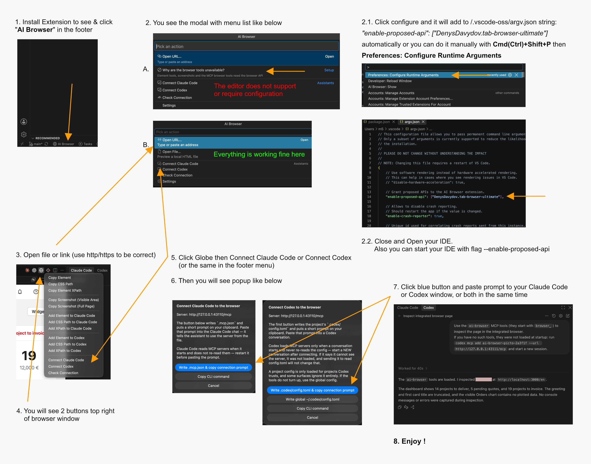

# 🚀 First integrated browser for VS Code editor with Claude Code, Codex, Gemini CLI and OpenCode support 🎆

> **Want the full version?** [HoverDeck](https://open-vsx.org/extension/DenysDavydov/hoverdeck)
> is AI Browser plus a chat of its own — Claude Code, Codex, Gemini CLI and more in one panel,
> with terminals and workflows ([GitHub](https://github.com/Denis-Davidoff/hoverdeck)). It copies
> your `aiBrowser.*` settings on first start, and the two can be installed side by side.

- 🌐 **VS Code’s built-in browser or Google Chrome:** work in a native browser tab inside the
  editor where available, or let your assistant drive Google Chrome without a Chrome extension.
- 🤖 **Your assistants, your way:** keep the Claude Code and Codex extensions, Gemini CLI or
  OpenCode you already use — one command connects each of them to the browser.
- 🔌 **A built-in MCP server** that connects the browser to Claude Code, Codex, Gemini CLI or any
  other assistant that speaks MCP.
- 🎯 **Pick an element on the page** and send its address or metadata straight to Claude Code or
  Codex.
- 🛠️ **Full DevTools for every tab.**
- 🔗 **Per-assistant tab access:** share a tab with one assistant and it sees and drives that tab
  only, while the others stay hidden from it.
- 🔑 **A password manager for sites:** it offers to save a login after a sign-in that worked and
  fills it back, with passkeys too, all kept in VS Code's secret storage.
- 🌍 **Translate, modify and restore content on the page:** your assistant rewrites all of its
  text in place — translate it, stress-test the layout with long labels, try new copy, or mask
  personal data before a screenshot. Only the open page changes; a reload restores it.

## 🌐 Browser options by editor

AI Browser works with **VS Code’s native browser** and **Google Chrome**. In editors that
expose the `browser` API, pages can open directly inside the editor. In other editors, use
Google Chrome with the same browser tools for your assistant.

The native browser availability below was checked in shipped builds on **2026-09-09**;
it may change in newer releases. Google Chrome is also an option in the editors with native tabs.

| Editor | Version checked | VS Code Browser | Google Chrome | How to install |
|---|---|---|---|---|
| **VSCodium** | 1.135 | ✅ | ✅ | Open VSX |
| **Devin** (Windsurf) | 1.126 | ✅ | ✅ | Open VSX |
| **VS Code** | 1.137 | ✅ | ✅ | Install the `.vsix` |
| **Cursor** | 3.19.19 | — | ✅ | Open VSX or `.vsix` |
| **Antigravity IDE** | 1.107 | — | ✅ | Open VSX or `.vsix` |
| **Kiro** | 1.0.437 | — | ✅ | Open VSX or `.vsix` |
| **Trae** | 1.107.1 | — | ✅ | Install the `.vsix` |

For native tabs, run **AI Browser: Enable Integrated Browser API** (also the orange status bar
button); then quit and reopen the editor. For Chrome, choose **Open Google Chrome for your
agent** in the status bar menu, select your assistant, and paste the copied prompt into its
chat; no setup is needed. Chrome needs to be installed on the same computer,
and this mode runs from a local editor window.

**Setup at a glance** — the whole path in eight numbered steps; click the picture for full size:

[](https://raw.githubusercontent.com/Denis-Davidoff/vs-code-tab-browser-ultimate/main/ai-browser-instruct.jpg)

See the [Privacy Policy](PRIVACY.md) for data handling, storage and provider sharing.

## 💬 Looking for the chat?

The AI Browser chat — Claude Code, Codex, Gemini CLI, OpenCode, Pi and OpenRouter in one panel,
terminal tabs, the Chrome side panel and Exchange — moved to its own extension,
[**HoverDeck**](https://open-vsx.org/extension/DenysDavydov/hoverdeck), on 2026-11-14. This build
is the browser and its MCP tools without the chat. Both can be installed side by side.

## 📍 Page annotations

**Add Annotation Marker** on the browser tab pins a numbered note to an element you click.
**Copy Annotation Prompt** hands the notes to your assistant, and assistants read, add and remove
notes through the `browser_annotations_*` MCP tools. Details: [CLAUDE.md](CLAUDE.md#page-annotations).

## 🎥 Browser video recording

Record the browser page without OS screen recording permission. Videos are silent,
saved as MP4 when supported or WebM otherwise. Pick **1080p**, **1440p** (default) or **4K**
under **Record Video ▸** in the browser tab's menu.

- **From the browser tab:** **Record Video ▸**, then **Pause / Resume** and **Stop** in the
  tab's toolbar. Stop copies the file path to the clipboard.
- **Claude Code / Codex:** **Copy Recording Prompt** in the assistant's submenu.
- **MCP:** use `browser_recording_start`, `browser_recording_pause`,
  `browser_recording_resume`, `browser_recording_stop` and `browser_recording_status`.

Encoding happens in the **Video Recorder** view in the panel area; it opens by itself the first
time and must stay open while a recording runs. Keep the page visible while recording.
For limits, settings and technical details, see [CLAUDE.md](CLAUDE.md#browser-video-recording).

## 📝 Changelog

See [CHANGELOG.md](CHANGELOG.md).

## 📦 How to install

Choose the browser you want to use: **native tabs inside the editor** or **Google Chrome**.
For native tabs, run **AI Browser: Enable Integrated Browser API** (also under *Setup* in the
status bar menu) to check your editor and enable access. For Chrome, choose
**Open Google Chrome for your agent** in the status bar menu; no Browser API setup is needed.

> **The fastest way in is the VSIX in this repository:**
> [**tab-browser-ultimate.vsix**](https://github.com/Denis-Davidoff/vs-code-tab-browser-ultimate/raw/main/tab-browser-ultimate.vsix)
> → **Extensions: Install from VSIX…**. It is the current build.
>
> [**Open VSX**](https://open-vsx.org/extension/DenysDavydov/tab-browser-ultimate) carries the
> same build, and is the one-click route on VSCodium, Devin, Cursor and Windsurf —
> see the table above for the browser option in each editor. The
> [**VS Code Marketplace**](https://marketplace.visualstudio.com/items?itemName=DenysDavydov.tab-browser-ultimate-promo)
> entry is the guide and the download link, not the extension itself — the Marketplace does not
> accept an extension that declares API proposals. See [Installing](#installing) below.
>
> For native browser tabs there is **one step after installing**: the extension declares two API
> proposals (`externalUriOpener`, `browser`) and an editor only grants those to an extension
> named with `--enable-proposed-api`. Click the orange **Enable Browser API** button in the
> status bar and it writes that for you — see
> [Enabling the browser API](CLAUDE.md#enabling-the-grant-in-one-click).

For native tabs, press `Cmd`/`Ctrl` + `Shift` + `P` to open the command palette, run
**AI Browser: Show**, and enter the URL. For Google Chrome, use the status bar action above
and ask your assistant to open the page.

**Your browser, wired to your AI assistant: use native editor tabs or Google Chrome and let
the agent drive the page. In native tabs, you can also pick an element and send it as a prompt.**

Front-end work is a loop: look at the page, find the element, describe it to the assistant,
check what changed. Screenshots lose the markup, hand-copied class names go stale, and a
headless browser opens a session you are not logged into. This extension closes the loop inside
the editor: the page you are looking at is the page your agent reads and drives.

- 🌐 **VS Code's built-in browser, not a webview approximation.** Pages open in the editor's own
  browser editor — a real Chromium tab with history, find in page, page zoom, DevTools and
  working keyboard shortcuts. The extension attaches to it over the Chrome DevTools Protocol,
  the same channel the editor uses for its own browser features.
- 🎯 **Click an element, get the whole story.** One pick returns a report: what the element is,
  where it sits in the html, its outer markup, its box, and the css that actually applies to it
  — matched rules in cascade order, inherited rules, resolved values and css variables. Hover
  highlighting comes from the DevTools overlay, so picking feels like the inspector.
- 📍 **Or just its address.** A CSS selector or an XPath, built to survive the next rebuild:
  both anchor on a unique `id` when there is one and add a positional predicate only where a
  tag really repeats; the selector deliberately leaves utility class names out. **Copy CSS
  Path + Location** puts the page in front of it — `http://localhost:3000/checkout → #main >
  li:nth-of-type(2)` — so an assistant reading it knows which route the selector belongs to
  instead of guessing, in the order it will use them: navigate, then find. It arrives on the
  clipboard already wrapped as inline code, ready to paste into a chat message.
- ✨ **One click turns it into a prompt.** Send the element, its selector or its path straight
  into Claude Code or Codex as a file their agent reads — so "make this button match the one
  above" is a sentence, not a paragraph of description.
- 📸 **Screenshots that paste as pictures.** The visible area or the whole scrollable page, on
  the system clipboard as a real PNG — `Cmd`/`Ctrl` + `V` into a chat, an issue or a document.
- ⌨️ **One key repeats what you did last.** The toolbar's right-hand button and
  `Cmd`/`Ctrl` + `Alt` + `C` both run the action you used last, whichever of the fourteen it was.
- 🔌 **An MCP server, with nothing to install.** No package, no separate process to babysit: the
  extension starts a local server on activation, and one command configures Claude Code, Codex,
  Gemini CLI, OpenCode, VS Code's own chat or any other MCP client to use it.
- 🤖 **Then the agent drives the page itself.** Nineteen tools: snapshot what is clickable, read
  the html or the text, inspect an element, click, fill fields, scroll, wait for a render,
  screenshot, navigate — then read the console to see what its own change actually did. Reading,
  clicking, filling, scrolling and waiting work inside embedded frames too, frames from other
  sites included.
- 🌐 **Translate a page with your own assistant.** Pick a language, paste the prompt it copies into
  Claude Code, Codex, Gemini CLI or any agent connected to the MCP server, and the page's text is replaced in
  place — no translation service, and text the page re-renders keeps its translation; new text
  needs another run.
- 👀 **In your session, not a fresh one.** Same cookies, same dev server, same logged-in state,
  already past the auth wall you passed this morning. You watch every step happen in the tab and
  can take the mouse back at any point.
- 🔒 **Local by construction.** Loopback only, a bearer token per workspace, and any request
  carrying an `Origin` header refused before its credentials are looked at.
- 🔑 **Saved logins and passkeys.** After a sign-in that worked, the status bar offers to save the
  password — or to update one that changed; a sign-in form gets one-click filling, and
  `Cmd`/`Ctrl` + `Shift` + `L` fills from anywhere on the page. Sites can create and use passkeys,
  each one confirmed in VS Code first — a VS Code prompt for now, not Touch ID or Windows Hello;
  a passkey request from an embedded frame of another site is not served while passkeys are on.
  Everything lives in VS Code's secret storage, encrypted by the operating system (on Linux, only
  when a keyring is available), exports to a passphrase-protected file, and imports from Chrome,
  Firefox, Safari, Bitwarden or 1Password. Nothing is drawn into the page, and no MCP tool returns a
  password value — though an assistant you share a tab with can still click a page's own
  "show password" button and take a screenshot.

It started as a standalone copy of the Simple Browser extension that ships with VS Code,
repackaged so it can be built, installed and extended on its own. That panel is still in here
(`aiBrowser.useIntegratedBrowser: false`). The native tab toolbar uses the editor’s own browser;
the assistant’s browser tools work with both native tabs and Google Chrome.

## Try another useful extension: Task & Script Explorer

Visual Studio Code Marketplace link: https://marketplace.visualstudio.com/items?itemName=DenysDavydov.task-runner-ultimate

Open VSX Registry link: https://open-vsx.org/extension/DenysDavydov/task-runner-ultimate

## 🛠️ The toolbar on the browser tab

Open a page — `Cmd`/`Ctrl` + click a localhost url a dev server printed, or run
**AI Browser: Show** — and the browser tab gets two buttons of its own:

- **a globe**, which opens a menu holding everything the extension does;
- **a crosshair**, which repeats the entry you used last. Its colour says which one: red for the
  element, blue for the css path, purple for the css path + location, green for the xpath, with a
  ring around it when the destination is Claude Code or Codex rather than the clipboard. After **Add Annotation Marker** it is a map pin instead, and adds another marker.

`Cmd`/`Ctrl` + `Alt` + `C` runs whatever that second button shows, and is inert outside a
browser tab. Every entry except Open New Browser Tab is also in the command palette under
**AI Browser**.

The menu, in order:

| Entry | Result |
| --- | --- |
| Open New Browser Tab | an empty browser tab |
| Connect Claude Code / Connect Codex | writes the assistant's config and shares this tab with it — the same entries as in the submenus below; Connect Gemini CLI is in its own submenu |
| Copy Element | the full context as Markdown — element, url, html path, outer html, dimensions, matched css |
| Copy CSS Path | `#main > div > li:nth-of-type(2)` |
| Copy CSS Path + Location | the page and the selector on one line, wrapped as inline code: `http://localhost:3000/a/b → #main > div > li:nth-of-type(2)` |
| Copy Element XPath | `//*[@id="main"]/span`, or `/html/body/ul/li[2]` when nothing stable can anchor it |
| Copy Screenshot (Visible Area) | a PNG of what is on screen, on the clipboard |
| Copy Screenshot (Full Page) | the whole scrollable page, truncated past 16384 device pixels |
| Translate Page… | asks for a language and copies a prompt to paste into your assistant, which translates the page in place — [CLAUDE.md](CLAUDE.md#translating-a-page-through-an-assistant) |
| Add Annotation Marker | pin a note to an element you click — [Page annotations](#-page-annotations) |
| Remove All Annotation Markers / Copy Annotation Prompt | only while the page has markers: clear them, or copy a prompt that hands the notes to your assistant |
| Claude Code ▸ | a submenu: the same four picks handed to the Claude Code chat, plus Connect and Share Tab |
| Codex ▸ | the same, for Codex |
| Gemini CLI ▸ | Connect Gemini CLI, Share Tab with Gemini CLI and Open Gemini CLI in Terminal — Gemini has no VS Code chat to hand a pick to, so there are no Add entries |
| Check Connection | the mcp server, [CLAUDE.md](CLAUDE.md#mcp-the-browser-exposed-to-claude-code-codex-and-vs-code-chat) |
| Logins and Passkeys ▸ | fill a saved login, save the one on the page, manage, import, export — [CLAUDE.md](CLAUDE.md#saved-logins-and-passkeys) |
| Share Tab with All Assistants / Stop Sharing Tab | [CLAUDE.md](CLAUDE.md#mcp-the-browser-exposed-to-claude-code-codex-and-vs-code-chat) |

Everything belonging to one assistant lives in that assistant's submenu, which is what keeps the
top level short. The four **Add** entries there appear only for an assistant whose
extension is actually installed and can take a report in this window — Claude Code's need a local
folder open, and neither works in a remote window; **Connect** and **Share Tab** are always there, because an
assistant driven from a terminal through `.mcp.json` needs them and has no extension to detect.
The menu is attached to the browser tab — from anywhere else, use the command palette.

Picking is single-flight: starting a pick cancels one already waiting, so the clipboard always
holds the action you chose last rather than one you had abandoned.

---

Everything below this point — what each command writes, the mcp server and its tools, sharing a
tab, the settings and command reference, installing, the `argv.json` grant, and the build — is
in **[CLAUDE.md](CLAUDE.md)**, which is the project's working reference and is kept current with
the code.

## Use from another extension

Driving the browser from another extension is what the fork was originally for:

```ts
await vscode.commands.executeCommand('aiBrowser.api.open', vscode.Uri.parse('http://localhost:3000'), {
    viewColumn: vscode.ViewColumn.Beside,
    preserveFocus: true,
});
```

A plain string works too, and is relayed exactly as given — prefer it for an address whose query
carries encoded characters such as `%26`, which a `vscode.Uri` decodes.

The extension also registers an external uri opener for `http` and `https`, but only for
localhost-like hosts (`localhost`, `127.0.0.1`, `0.0.0.0` and the IPv6 equivalents) — so a
forwarded port offers to open here, and every other url still goes to your system browser.

## Installing

It is not on the VS Code Marketplace: the Marketplace does not accept an extension that declares
API proposals. Install [`tab-browser-ultimate.vsix`](tab-browser-ultimate.vsix) from this
repository with **Extensions: Install from VSIX…**. For native tabs, run **AI Browser: Enable
Integrated Browser API** and quit and reopen the editor. To use Google Chrome, choose
**Open Google Chrome for your agent** in the status bar menu. See the
[browser options by editor](#-browser-options-by-editor) above and [CLAUDE.md](CLAUDE.md) for details.

## License

MIT, with both copyright lines — Microsoft's, for the forked and copied code, and this
project's. The per-file MIT headers on everything copied from vscode stay where they are.
One file, `src/logins/loginFormScript.ts`, is ported from Firefox's password manager and stays under
the Mozilla Public License 2.0 — see [THIRD-PARTY-NOTICES.md](THIRD-PARTY-NOTICES.md).

